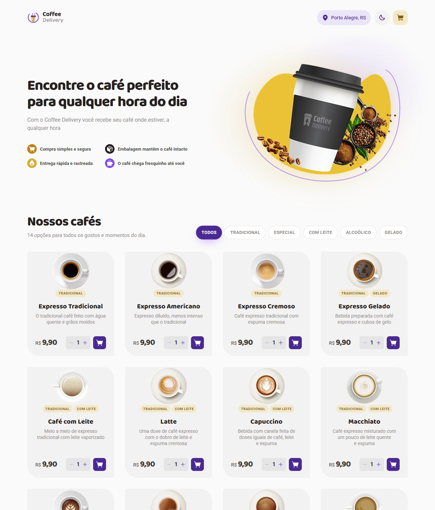
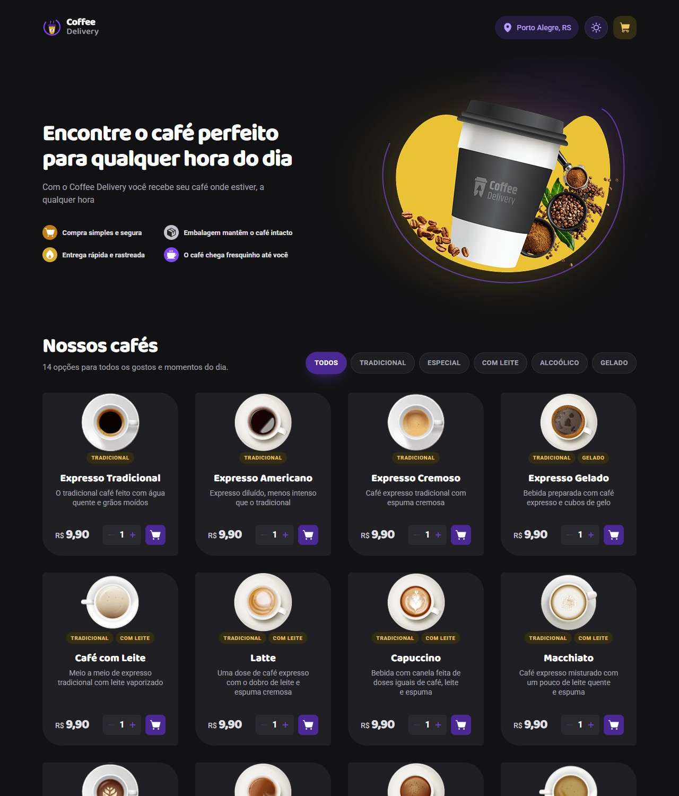
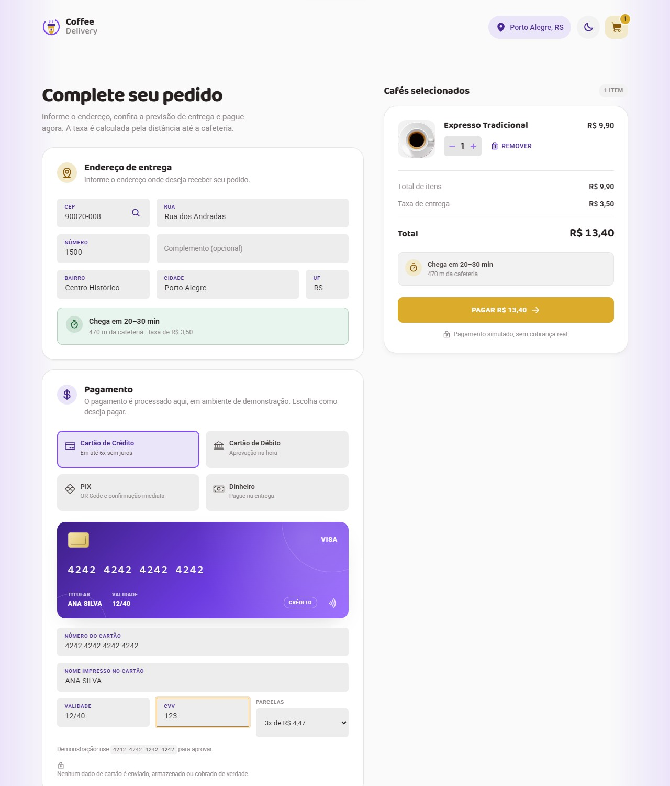
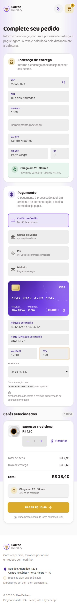
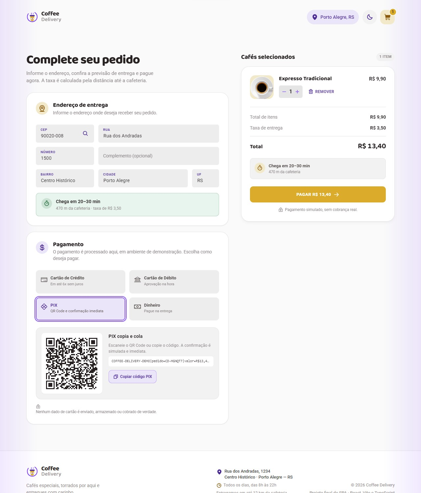
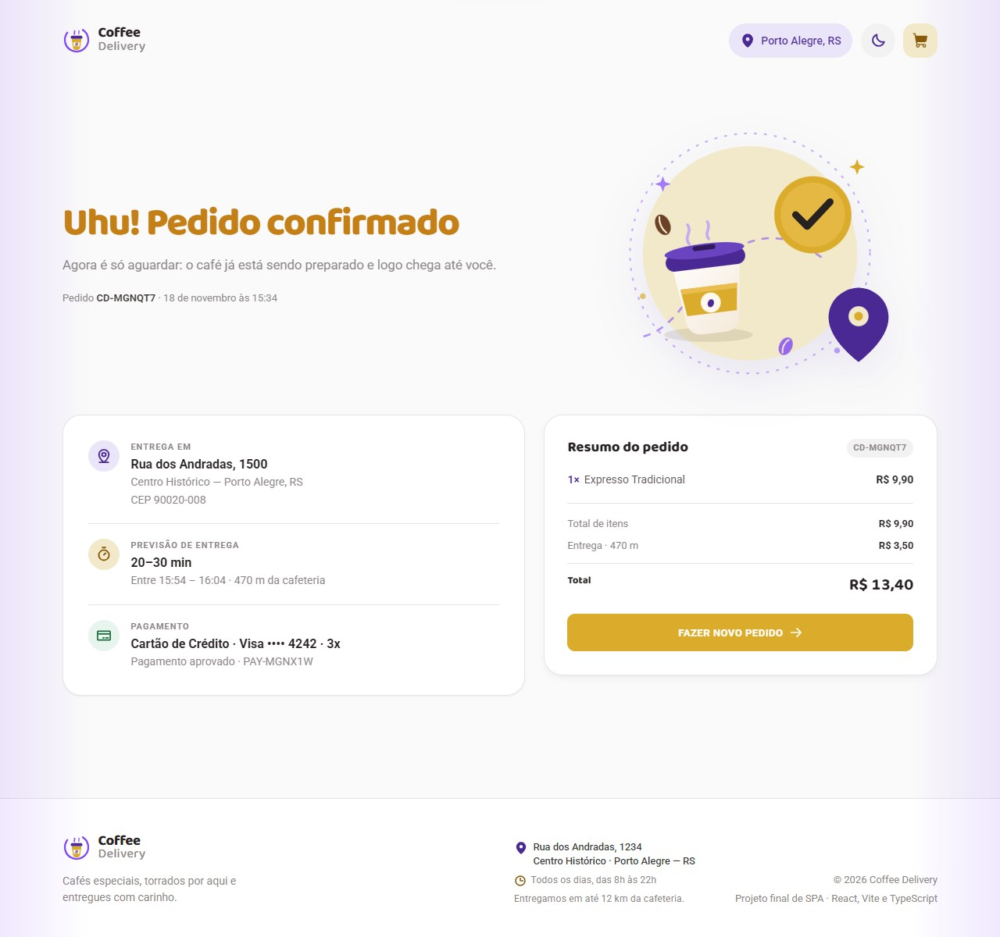
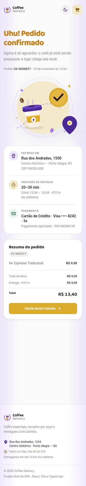
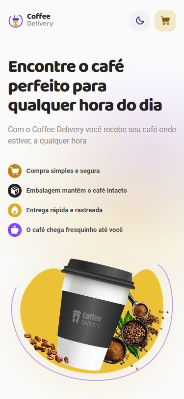
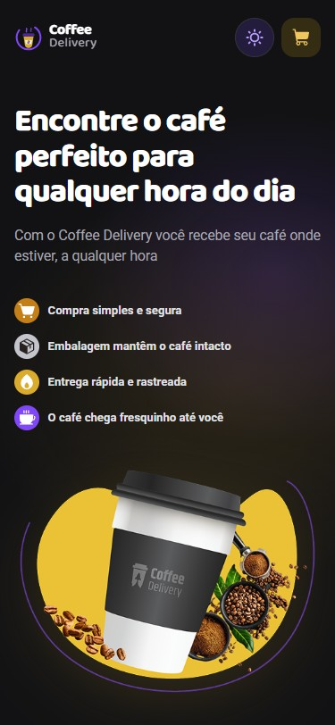

<div align="center">

# ☕ Coffee Delivery

**Delivery de cafés especiais — SPA React + TypeScript**

[](https://react.dev/)
[](https://www.typescriptlang.org/)
[](https://vite.dev/)
[](https://vitest.dev/)
[](https://playwright.dev/)
[](#-contexto-acadêmico)

Projeto final da disciplina de **Single Page Application (SPA)**.  
Catálogo de 14 cafés, carrinho persistente, checkout com ViaCEP, **frete por distância real**, **pagamento simulado** de ponta a ponta e temas claro/escuro.

[Funcionalidades](#-funcionalidades) · [Screenshots](#-screenshots) · [Stack](#-stack) · [Como rodar](#-como-rodar) · [Testes](#-testes-e-qualidade) · [Uso de IA](#-uso-de-inteligência-artificial)

</div>

---

## 📖 Sobre o projeto

O **Coffee Delivery** é uma cafeteria fictícia no Centro Histórico de Porto Alegre. A aplicação simula o fluxo completo de compra:

1. O cliente explora o catálogo e filtra por categoria.
2. Escolhe a quantidade e adiciona ao carrinho (com toast de confirmação).
3. Informa o CEP — o endereço é preenchido pelo **ViaCEP**.
4. A aplicação geolocaliza o endereço, calcula a **distância rodoviária até a cafeteria**, a **taxa por faixa** e a **previsão de entrega**.
5. Escolhe crédito (até 6x), débito, PIX ou dinheiro e o **pagamento é processado na própria SPA** (simulação acadêmica).
6. Recebe a confirmação com código do pedido, distância, janela de entrega, status do pagamento e resumo financeiro.

Todo o estado do carrinho e o tema escolhido sobrevivem a recarregamentos. Não existe backend, autenticação ou gateway real: o foco é a excelência técnica da SPA.

> **Marca:** **Coffee Delivery**, com logo, favicon e ilustração de sucesso vetoriais originais. O hero e as 14 fotos de café são PNGs fornecidos no projeto.

---

## ✨ Funcionalidades

- **Catálogo com 14 cafés** — nome, descrição, tags, preço em centavos e foto PNG.
- **Filtros por categoria** — Todos, Tradicional, Especial, Com Leite, Alcoólico e Gelado.
- **Carrinho reativo** — adicionar, acumular quantidades, incrementar, decrementar (remove ao chegar em 1), remover e limpar.
- **Persistência** — carrinho no `localStorage`; último pedido no `sessionStorage`.
- **Badge dinâmico** no header, com animação a cada mudança de contagem.
- **Toasts globais** — confirmação ao adicionar, com até 3 avisos simultâneos e dispensa manual ou automática em 4,5 s.
- **Checkout validado** com React Hook Form + Zod (`onTouched`), máscara de CEP e mensagens acessíveis.
- **ViaCEP** — consulta automática ao completar 8 dígitos, botão de nova consulta, tratamento de CEP inexistente e falha de rede.
- **Entrega por distância real** — coordenadas via BrasilAPI/Nominatim, Haversine com fator viário, quatro faixas de taxa, janela de previsão e bloqueio acima de 12 km.
- **Pagamento simulado completo** — cartão de crédito/débito com validação Luhn, validade e CVV; PIX com QR Code e código copia e cola; dinheiro com troco.
- **Estados de processamento** — overlay com etapas, cancelamento ao desmontar e tratamento de cartão recusado.
- **Resumo financeiro** — subtotal, taxa de entrega e total, calculados em centavos inteiros.
- **Tela de sucesso** — snapshot do pedido, distância, janela de entrega, status/transação, cartão mascarado e confete.
- **Estados vazios** — checkout sem itens e `/success` acessada sem pedido.
- **Tema claro/escuro** — persistido, com preferência do sistema e aplicação antes do primeiro paint.
- **Efeitos de UI em Tailwind CSS v4** — header com sombra ao rolar, hover/foco com transição, **halo pulsante no hero**, **glow nos botões** e sweep de brilho nas CTAs, além de animações de entrada/toast/confete e `prefers-reduced-motion`.
- **Acessibilidade** — skip link, landmarks, foco visível, labels, `aria-label`, `aria-live`, contraste AA e alvos de toque de 44px.
  - Exceções documentadas (fidelidade ao Figma): `--text-label` `#8D8686` (3,05–3,57:1) e CTA amarelo com rótulo branco (`#FFFFFF`/`#DBAC2C`); a suíte a11y isola apenas esses dois pares na regra `color-contrast`.
- **Responsividade** — validada em 320, 375, 768 e 1280+ sem scroll horizontal.

### Rotas

| Rota | Tela |
|---|---|
| `/` | Home, hero e catálogo |
| `/checkout` | Endereço, entrega, pagamento e resumo |
| `/success` | Confirmação do pedido |
| `*` | Página 404 |

---

## 📸 Screenshots

### Home — tema claro



### Home — tema escuro



### Checkout com cartão

<p align="center">
  
  
</p>

### Checkout com PIX



### Confirmação

<p align="center">
  
  
</p>

### Home no mobile

<p align="center">
  
  
</p>

> As capturas são geradas por `node scripts/capture-screenshots.mjs` com dados de CEP mockados, viewport fixo e `reducedMotion: reduce`.

---

## 🧱 Stack

| Camada | Tecnologia | Por quê |
|---|---|---|
| UI | **React 19** | Componentes funcionais, Hooks e composição. |
| Estilos | **CSS Modules + Tailwind CSS 4** | Layout/cores nos módulos; efeitos (hover, transições, sombras, animações) via utilities e tokens Tailwind. |
| Linguagem | **TypeScript 7 (strict)** | Sem `any`, sem casts inseguros; contratos explícitos. |
| Build | **Vite 8** | Dev server rápido e build otimizado. |
| Rotas | **React Router 7** | SPA com histórico do navegador. |
| Estado global | **Context API + `useReducer`** | Carrinho imutável e previsível. |
| Formulários | **React Hook Form 7 + Zod 4** | Validação declarativa e tipada. |
| Estilos | **CSS Modules + design tokens** | Escopo local, temas via variáveis CSS, zero runtime. |
| Ícones | **Phosphor Icons** | Consistência visual e peso ajustável. |
| QR Code | **qrcode.react** | QR Code 100% local para o PIX de demonstração. |
| Testes unitários | **Vitest 5 + Testing Library** | Testes rápidos no ecossistema Vite. |
| E2E | **Playwright + axe-core** | Fluxo real em Chrome, responsividade e auditoria WCAG. |
| Lint | **oxlint** | Feedback instantâneo no CI/local. |

> A decisão de usar **CSS Modules** em vez de Tailwind está registrada em [`docs/TECH_SPEC.md`](docs/TECH_SPEC.md) e em [`docs/AI_USAGE.md`](docs/AI_USAGE.md).

---

## 🏗️ Arquitetura

```
src/
├── assets/              # logo, favicon, hero (Imagem.png), fotos dos cafés e sucesso
├── components/          # Header, Logo, ThemeToggle, CoffeeCard, CartItem,
│                        # QuantityInput, EmptyState, Footer, ToastViewport
├── contexts/            # Cart, Theme e Toast (Context + Provider)
├── data/                # catálogo tipado com 14 cafés
├── hooks/               # useCart, useTheme, useToast, useViaCep
├── layouts/             # DefaultLayout com skip link, header, main e footer
├── pages/               # Home, Checkout (AddressForm, PaymentSelector,
│                        # CartSummary, ProcessingOverlay), Success, NotFound
├── reducers/            # cartReducer + action creators
├── schemas/             # checkoutSchema (Zod condicional por método)
├── services/            # viaCep, coordinates, delivery, payment
├── styles/              # tokens, reset, utilitários e motion
├── tests/               # 11 arquivos / 124 testes unitários
├── types/               # coffee, cart, delivery, order
└── utils/               # cep, geo, card, order, totals, storage, guards, constants
e2e/                     # home, checkout, responsive e a11y (Playwright)
scripts/                 # captura de screenshots para a documentação
```

### Fluxo de estado

```
CoffeeCard ──addItem──▶ CartProvider (useReducer) ──▶ localStorage
                              │
                              ├── Header (badge)
                              ├── ToastProvider (feedback)
                              ├── Checkout (itens/totais + entrega + pagamento)
                              └── Success (snapshot em sessionStorage)
```

- **`CartProvider`** hidrata o carrinho do `localStorage`, descarta itens fora do catálogo e reidrata preços atuais.
- **`cartReducer`** é puro: toda transição retorna um novo objeto.
- **`ThemeProvider`** aplica `data-theme` no `<html>`, atualiza `theme-color` e persiste a escolha.
- **`ToastProvider`** mantém no máximo 3 avisos e limpa os timers ao desmontar.
- **`Success`** lê o pedido do `location.state` ou do `sessionStorage`, protegendo acesso direto.

### Persistência

| Chave | Storage | Conteúdo |
|---|---|---|
| `@coffee-delivery:cart-state-1.0.0` | `localStorage` | Itens e quantidades |
| `@coffee-delivery:theme-1.0.0` | `localStorage` | `"light"` ou `"dark"` |
| `@coffee-delivery:last-order-1.0.0` | `sessionStorage` | Snapshot do último pedido |

---

## 📍 Entrega por distância

A cafeteria fica em **Rua dos Andradas, 1234 — Centro Histórico, Porto Alegre/RS (CEP 90020-008)**, coordenadas **-30.029495, -51.229538**.

1. O CEP é resolvido pelo ViaCEP (rua, bairro, cidade, UF).
2. As coordenadas vêm da **BrasilAPI CEP v2**; se indisponível, o endereço é geocodificado no **Nominatim**.
3. A distância em linha reta usa **Haversine** e recebe um fator viário de **1,25**.
4. A taxa segue quatro faixas de distância rodoviária:

| Distância | Taxa |
|---|---|
| até 1,5 km | R$ 3,50 |
| até 4 km | R$ 5,90 |
| até 8 km | R$ 8,90 |
| até 12 km | R$ 12,90 |
| acima de 12 km | **entrega bloqueada** |

5. A previsão é `12 min de preparo + distância ÷ 24 km/h + 5 min de folga`, arredondada para cima em múltiplos de 5, com janela de **10 minutos** (ex.: `20–30 min`).
6. Sem coordenadas, mas na mesma cidade, a aplicação usa uma **estimativa de 2,5 km** e sinaliza isso na interface. Fora de Porto Alegre, bloqueia.

> Exemplo real: CEP `90020-008` → ~0,47 km rodoviários → **R$ 3,50** e **20–30 min**. CEP `01310-100` (São Paulo) → fora da área.

---

## 💳 Pagamento simulado

O pagamento acontece no checkout, sem gateway e sem cobrança real. Nenhum dado sensível é persistido.

| Método | Comportamento |
|---|---|
| **Crédito** | Luhn + validade + CVV; até 6 parcelas sem juros; preview animado do cartão. |
| **Débito** | Mesmas validações, sem parcelamento. |
| **PIX** | QR Code local + código copia e cola de demonstração; confirmação imediata. |
| **Dinheiro** | Pagamento na entrega, com campo opcional de troco. |

- Cartão de teste aprovado: **4242 4242 4242 4242**.
- Cartões terminados em **0002** são recusados para exercitar o fluxo de erro.
- O pedido guarda apenas bandeira, **4 últimos dígitos** e parcelas — nunca o número completo.
- A simulação leva 1,8 s e mostra etapas de processamento; desmontar o checkout aborta a operação.

---

## 🚀 Como rodar

### Pré-requisitos

- Node.js 20+ (testado com Node 26)
- npm
- Google Chrome instalado (o Playwright usa o canal `chrome`)

### Instalação

```bash
git clone https://github.com/wesleymiguelweb/coffeCommerce.git
cd coffeCommerce
npm install
npm run dev
```

Abra `http://localhost:5173`.

### Scripts

| Comando | Descrição |
|---|---|
| `npm run dev` | Servidor de desenvolvimento com HMR |
| `npm run build` | `tsc -b` + build de produção |
| `npm run preview` | Pré-visualiza o build |
| `npm run test` | Vitest em watch mode |
| `npm run test:run` | Vitest uma vez |
| `npm run test:e2e` | Playwright: build + preview + 19 testes |
| `npm run test:e2e:ui` | Playwright em modo UI |
| `npm run test:a11y` | Apenas a suíte axe |
| `npm run test:e2e:report` | Abre o relatório HTML |
| `npm run lint` | oxlint |

### Build de produção

```bash
npm run build
npm run preview
```

O build atual gera **~535 kB de JS (162,5 kB gzip)** e **~48,6 kB de CSS (9,8 kB gzip)**, além das imagens. O Vite alerta que o chunk principal passa de 500 kB; a próxima otimização natural é separar Checkout/Success com `lazy()`.

---

## 🌐 APIs externas

| API | Uso | Tratamento |
|---|---|---|
| **ViaCEP** | Endereço a partir do CEP | Disparo ao completar 8 dígitos, `AbortController`, CEP inexistente e rede. |
| **BrasilAPI CEP v2** | Coordenadas do CEP | Timeout de 7 s; valida latitude/longitude. |
| **Nominatim (OSM)** | Coordenadas por endereço | Fallback quando a BrasilAPI não retorna `location`. |

Nos testes E2E essas três APIs são **mockadas** com payloads reais, garantindo determinismo e execução offline.

---

## 🧪 Testes e qualidade

### Unitários — 124 testes / 11 arquivos

```bash
npm run test:run
```

Cobrem:

- `cartReducer` — adição, acúmulo, incremento, decremento/remoção, limpeza, entradas inválidas e imutabilidade.
- `calculateCartTotals` — carrinho vazio, quantidade e subtotal (o frete passou a depender do endereço).
- `formatCurrency` / `formatAmount` / `formatCurrencyInput` — BRL, zero, milhar, máscara e limite de dígitos.
- `checkoutSchema` — endereço, CEP, UF, cartão (Luhn, validade, CVV, parcelas), PIX e troco.
- `card` — Luhn, bandeira, validade, máscaras, parcelas e valor por parcela.
- `geo` — Haversine, fator viário e formatação de distância.
- `delivery` — faixas, limites, janela de ETA e fallback por cidade.
- `payment` — aprovação, recusa, PIX, ausência do número completo e abortamento.
- `cep`, `storage`, `guards` — máscara, persistência segura e validação de snapshots.

### E2E — 19 testes Playwright

```bash
npm run test:e2e
```

- **Home:** hero, 14 cards, toast, filtro, tema persistente e quantidade.
- **Checkout:** crédito com entrega por distância, débito, PIX com QR, dinheiro com troco, cartão recusado, fora da área e validação.
- **Responsividade:** 320, 375, 768 e 1280 sem overflow; empilhamento no mobile.
- **Acessibilidade:** axe em Home, Checkout e Success.

A configuração sobe `npm run build && npm run preview` na porta **4173** com `reuseExistingServer: false`, Chrome real, locale `pt-BR`, timezone `America/Sao_Paulo` e APIs externas mockadas.

### Acessibilidade

- **axe-core**: 0 violações WCAG 2.0/2.1 A/AA nas três telas, com duas exceções únicas e documentadas (fidelidade ao Figma): `fgColor #8D8686` e o par `fg #FFFFFF / bg #DBAC2C` na regra `color-contrast` — ver `e2e/a11y.spec.ts` e `docs/TECH_SPEC.md` §8.2.
- Skip link funcional, landmarks, labels associados e `aria-live` para toasts e processamento.
- Contraste e foco visível nos dois temas.
- Alvos de toque de 44×44 px em botões no mobile.
- `prefers-reduced-motion` desliga animações.

### Lint e tipos

```bash
npm run lint
npx tsc -b
```

`tsc` passa sem erros. O lint mantém **2 avisos** conhecidos (leitura de ref no render do Checkout e `setState` em efeito no `AddressForm`), ambos sem impacto funcional e documentados para refatoração futura.

---

## 🔐 Regras de negócio principais

- Quantidade mínima na Home: **1**.
- Item repetido acumula quantidade sem duplicar linha (chave: `coffee.id`).
- Decrementar de 1 remove o item.
- `Subtotal = Σ(preço × quantidade)` e `Total = Subtotal + Taxa de Entrega`.
- Todos os cálculos usam **centavos inteiros**.
- A taxa é definida pela **distância rodoviária**, não pelo CEP nem pelo valor do pedido.
- Acima de **12 km** o pedido é bloqueado com explicação.
- O pagamento é **simulado** — nenhuma cobrança real.
- Confirmar o pedido limpa o carrinho, mas preserva o snapshot.
- Acesso direto a `/success` sem pedido exibe estado vazio com CTA para o catálogo.

---

## 🤖 Uso de Inteligência Artificial

A IA foi usada como copiloto em todo o ciclo — requisitos, arquitetura, código, testes, auditoria visual e documentação — sempre com revisão humana. O detalhamento completo está em [`docs/AI_USAGE.md`](docs/AI_USAGE.md).

**Destaques:**

- Logo, favicon e ilustração de sucesso são SVGs originais criados com apoio de IA.
- O hero e as 14 fotos de café são **PNGs fornecidos no projeto**; a IA integrou os assets, ajustou recortes, sombras e o layout responsivo.
- A primeira versão usava ilustrações vetoriais geradas por script; elas foram substituídas pelos PNGs e removidas do repositório.
- Código, testes e documentação foram validados com build, lint, 124 testes unitários, 19 testes E2E e axe.

---

## 🎓 Contexto acadêmico

Projeto final da disciplina **Single Page Application (SPA)**.

**Requisitos atendidos:** RF-01 a RF-16 e RN-01 a RN-10 descritos em [`docs/PRD_SPEC.md`](docs/PRD_SPEC.md), com decisões técnicas em [`docs/TECH_SPEC.md`](docs/TECH_SPEC.md) e plano em [`docs/TASKS_SPEC.md`](docs/TASKS_SPEC.md).

**Fora de escopo:** backend próprio, autenticação, banco de dados, gateway de pagamento e rastreamento real em GPS. A entrega usa coordenadas públicas e uma estimativa de velocidade; não é roteamento de trânsito em tempo real.

---

<div align="center">

Feito com ☕ e React por **Wesley Miguel**.

</div>
