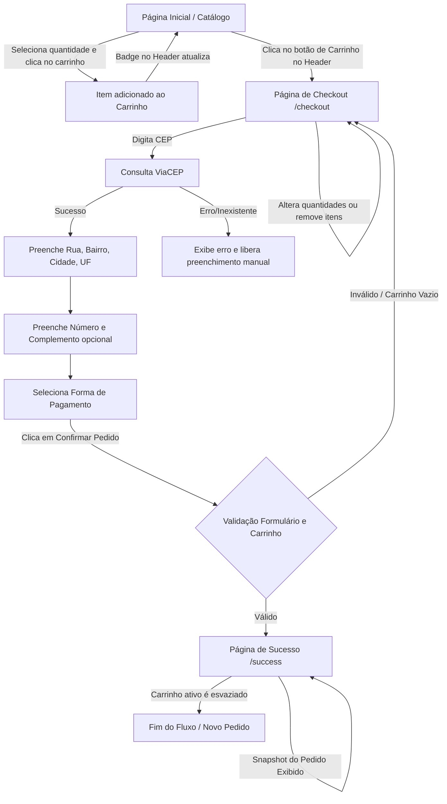

# Product Requirements Document (PRD) — Coffee Delivery

## 1. Visão Geral do Produto

O **Coffee Delivery** é uma aplicação web de e-commerce desenvolvida como Single Page Application (SPA) para uma cafeteria fictícia moderna. O sistema permite que clientes explorem um catálogo categorizado de cafés especiais, escolham quantidades, gerenciem um carrinho de compras reativo, informem o endereço de entrega com preenchimento automatizado via CEP, selecionem a forma de pagamento e concluam o pedido com emissão de um comprovante visual.

O projeto foi concebido para o Projeto Final da disciplina de Single Page Application (SPA), consolidando os principais padrões da arquitetura moderna com **React 19, TypeScript, Context API, useReducer e React Router**, aliado a uma identidade visual autoral gerada com Inteligência Artificial e suporte nativo a Dark Mode e acessibilidade.

---

## 2. Objetivos de Negócio e de Aprendizagem

### 2.1 Objetivos de Negócio
- Proporcionar uma experiência fluida de compra rápida de cafés ("delivery sob demanda").
- Reduzir o atrito no checkout através da busca automática de endereço via CEP (ViaCEP).
- Oferecer uma interface adaptável e acolhedora em qualquer dispositivo (mobile, tablet e desktop) com suporte a temas claro e escuro.

### 2.2 Objetivos de Aprendizagem
- Planejar detalhadamente antes de implementar (especificações PRD, TECH e TASKS).
- Transformar protótipos do Figma em componentes reutilizáveis e desacoplados.
- Modelar estados complexos e regras de negócio com **Context API + useReducer**, garantindo imutabilidade.
- Integrar formulários fortemente tipados e validados com **React Hook Form + Zod**.
- Implementar persistência local de dados no `localStorage`.
- Utilizar e documentar a assistência de Inteligência Artificial em todo o ciclo de desenvolvimento.

---

## 3. Público-Alvo e Personas

- **Consumidores de Café Espresso e Bebidas Especiais**: Usuários que buscam agilidade para pedir seu café favorito no trabalho ou em casa.
- **Usuários Mobile e Desktop**: Pessoas navegando em telas de diferentes dimensões (smartphones a monitores ultrawide).
- **Usuários com Preferências Visuais Específicas**: Usuários que preferem interfaces com alto contraste ou tema escuro (Dark Mode).

---

## 4. Escopo do Produto

### 4.1 O que está incluído no escopo (In-Scope)
- Catálogo com 14 variedades de café com imagens, títulos, descrições, tags de categorias e preços.
- Seleção de quantidade dinâmica no card do catálogo e nos itens do carrinho.
- Carrinho de compras com badge cumulativo no cabeçalho e persistência em `localStorage`.
- Fluxo de checkout com formulário de endereço de entrega integrado obrigatoriamente à API pública de CEP (ViaCEP).
- Seleção obrigatória de forma de pagamento (Cartão de Crédito, Cartão de Débito ou Dinheiro).
- Resumo financeiro transparente: Subtotal dos produtos, Taxa fixa de entrega e Total geral.
- Tela de confirmação e sucesso do pedido com dados consolidados da entrega e snapshot dos itens.
- Alternância de tema Light / Dark persistido no `localStorage` com detecção de preferência do sistema.
- Design totalmente responsivo (320px, 375px, 768px, 1280px+).
- Identidade visual autoral gerada com IA (marca, logo, favicon e documentação).

### 4.2 O que NÃO está incluído no escopo (Out-of-Scope)
- Backend próprio, APIs de autenticação ou banco de dados relacional remoto.
- Gateway de pagamento real ou processamento de cartão (o pagamento é meramente informativo/fictício).
- Autenticação e cadastro de usuários (login/senha).
- Rastreamento por GPS em tempo real do entregador.

---

## 5. Fluxos de Usuário (User Journeys)

---

## 6. Requisitos Funcionais (RF-01 a RF-16)

| ID | Requisito Funcional | Critério de Aceite |
|---|---|---|
| **RF-01** | Exibir catálogo de cafés com imagem, nome, descrição, preço e categoria/tag | Os produtos aparecem organizados em grid na Home, com todas as informações visíveis e fiéis ao design. |
| **RF-02** | Selecionar a quantidade de cada café antes de adicioná-lo | Controles de incremento (`+`) e decremento (`-`) funcionam com valor inteiro positivo (mínimo 1). |
| **RF-03** | Adicionar café ao carrinho e acumular quantidade de produto repetido | Ao adicionar um item que já existe no carrinho, sua quantidade é somada sem criar linhas duplicadas. |
| **RF-04** | Exibir contador de unidades no Header | O badge numérico sobre o ícone do carrinho reflete a soma total de todas as unidades de itens do carrinho. |
| **RF-05** | Aumentar, diminuir e remover individualmente itens do carrinho | Alterações no carrinho atualizam instantaneamente o badge, os subtotais e o total geral. Decrementar de 1 para 0 remove o item. |
| **RF-06** | Persistir carrinho com localStorage | Ao recarregar a página (F5) ou fechar e reabrir o navegador, os itens do carrinho permanecem preservados. |
| **RF-07** | Navegar entre Home, Checkout e Confirmação com React Router | Transição instantânea de rotas (`/`, `/checkout`, `/success`) como SPA, sem recarregamento total da página. |
| **RF-08** | Preencher e validar endereço de entrega consultando obrigatoriamente API de CEP | Ao digitar um CEP válido (8 dígitos), a aplicação consulta o ViaCEP e preenche automaticamente rua, bairro, cidade e UF. Número e complemento permanecem manuais. Tratar CEP inválido, não encontrado e falha de rede com mensagens claras. |
| **RF-09** | Selecionar uma forma de pagamento: crédito, débito ou dinheiro | O usuário deve selecionar obrigatoriamente uma das 3 opções de pagamento para habilitar a finalização da compra. |
| **RF-10** | Exibir subtotal dos produtos, taxa de entrega e total geral | Subtotal = soma de (preço × quantidade); Total = subtotal + frete (fixo em R$ 3,50). Cálculos em centavos para evitar erros de ponto flutuante. |
| **RF-11** | Impedir finalização com carrinho vazio ou formulário inválido | O botão de confirmação permanece desabilitado ou exibe mensagens de validação acessíveis caso haja campos pendentes ou carrinho sem itens. |
| **RF-12** | Confirmar pedido fictício e mostrar endereço e forma de pagamento | A tela `/success` exibe o endereço completo informado, previsão de entrega e método de pagamento escolhido. |
| **RF-13** | Limpar o carrinho após pedido confirmado, preservando os dados do pedido | O carrinho ativo é limpo no estado global, mas a tela de sucesso preserva os dados do pedido concluído via snapshot independente. |
| **RF-14** | Alternar entre light mode e dark mode | Botão no Header permite alternar entre os temas claro e escuro, afetando toda a interface e persistindo a escolha no `localStorage`. |
| **RF-15** | Adaptar layout, componentes, formulário e carrinho para dispositivos móveis | Layout 100% responsivo para telas de 320px, 375px, 768px e 1280px+, com toques ergonômicos e sem rolagem horizontal indesejada. |
| **RF-16** | Aplicar logo original desenvolvida com auxílio de IA | Logo autoral integrada ao Header, favicon do navegador e documentada com prompt e justificativa de branding. |

---

## 7. Regras de Negócio (RN-01 a RN-10)

- **RN-01 — Quantidades**: Na Home, a quantidade mínima para adição é 1. No carrinho de compras, o decremento de quantidade quando igual a 1 deve remover o produto do carrinho.
- **RN-02 — Produto Único**: A chave de identificação do item no carrinho é o seu `id`. Adições subsequentes do mesmo café somam a quantidade solicitada à quantidade já existente no carrinho.
- **RN-03 — Cálculo Financeiro e Frete**:
  - `Subtotal` = $\sum (\text{preço unitário} \times \text{quantidade})$.
  - `Taxa de Entrega` = valor fixo de **R$ 3,50** (definido como constante da aplicação).
  - `Total Geral` = $\text{Subtotal} + \text{Taxa de Entrega}$.
- **RN-04 — Precisão Monetária**: Todos os valores são calculados internamente em centavos inteiros (ex: R$ 9,90 = 990 centavos) e formatados para o padrão brasileiro `pt-BR` com símbolo `R$` e duas casas decimais (`R$ 9,90`).
- **RN-05 — Pagamento Informativo**: O método selecionado (Crédito, Débito ou Dinheiro) não executa transação bancária real; serve como especificação do pedido para a entrega.
- **RN-06 — Persistência e Snapshot**:
  - O carrinho ativo é persistido na chave `@coffee-delivery:cart-state-1.0.0` no `localStorage`.
  - Ao confirmar a compra, os dados do pedido formam um objeto `OrderSnapshot` imutável passado para a tela `/success` (armazenado em estado de navegação ou chave de último pedido), enquanto o carrinho de compras ativo é esvaziado.
- **RN-07 — Validação e Consulta de Endereço**:
  - CEP deve possuir 8 dígitos numéricos.
  - Campos obrigatórios: CEP, Rua, Número, Bairro, Cidade, UF.
  - Campo opcional: Complemento.
  - A consulta ao ViaCEP é acionada automaticamente quando o CEP atinge 8 dígitos válidos, exibindo indicador de carregamento.
  - Caso o CEP retorne erro (`erro: true`) ou a requisição falhe, o usuário é notificado e os campos de endereço são liberados para preenchimento manual.
- **RN-08 — Origem dos Dados do Catálogo**: O catálogo é provido por um módulo TypeScript fortemente tipado (`src/data/coffees.ts`), contendo as 14 opções de cafés com imagens otimizadas, tags e descrições.
- **RN-09 — Estados Vazios (Empty States)**:
  - Se o carrinho estiver vazio no checkout, uma mensagem amigável é exibida ("Seu carrinho está vazio") com botão para retornar ao catálogo.
  - Se a rota `/success` for acessada diretamente sem um pedido confirmado na sessão, o usuário é redirecionado para a Home ou recebe mensagem informativa com link para o catálogo.
- **RN-10 — Bloqueio de Navegação Inválida**: O botão de confirmar pedido é estritamente bloqueado caso o formulário possua erros de validação ou o carrinho possua 0 itens.

---

## 8. Requisitos Não Funcionais (RNF)

- **RNF-01 — Acessibilidade**: Seguir as diretrizes WCAG 2.2 nível AA:
  - Contraste mínimo de 4.5:1 para textos normais em ambos os temas (Light e Dark).
  - Rótulos acessíveis (`aria-label`) em botões iconográficos (botões de quantidade, remover, carrinho, alternador de tema).
  - Navegação completa por teclado (Tab, Enter, Espaço) com indicador visual de foco visível (`focus-visible`).
- **RNF-02 — Responsividade**:
  - Breakpoints definidos: Celular pequeno (320px-375px), Celular padrão (390px-480px), Tablet (768px), Desktop (1024px-1440px).
  - Não apresentar overflow horizontal.
  - Alvos de toque (touch targets) com no mínimo 44x44px em botões interativos para dispositivos móveis.
- **RNF-03 — Desempenho e Boas Práticas**:
  - Renderizações controladas no React, evitando renders desnecessários através de imutabilidade e estrutura de componentes limpa.
  - Bundle otimizado via Vite com build de produção sem erros de TypeScript e linter (`oxlint`).
- **RNF-04 — Compatibilidade de Navegadores**: Suporte aos navegadores modernos (Chrome, Firefox, Safari, Edge).
- **RNF-05 — Tipagem Estrita**: TypeScript configurado em modo estrito, sem uso de `any` ou type casting inseguro.

---

## 9. Identidade Visual e Branding com IA

### 9.1 Conceito da Marca
- **Nome da Marca**: **Aura Coffee Delivery** (ou Coffee Delivery com identidade visual proprietária).
- **Conceito**: Uma cafeteria artesanal e acolhedora que une o aconchego do café premium à velocidade e tecnologia da entrega expressa.
- **Paleta de Cores**:
  - **Amarelos (Energia, Calor, Entrega)**: Yellow Dark (`#C47F17`), Yellow (`#DBAC2C`), Yellow Light (`#F1E7C4`).
  - **Roxos (Sofisticação, Criatividade, Café Especial)**: Purple Dark (`#4B2995`), Purple (`#8047F8`), Purple Light (`#EBE5F9`).
  - **Neutros Light**: Fundo (`#FAFAFA`), Superfície/Card (`#F3F2F2`), Input (`#EDEDED`), Texto (`#574F4D`), Título (`#272221`).
  - **Neutros Dark**: Fundo (`#121214`), Superfície/Card (`#202024`), Input (`#1a1a1e`), Texto (`#E1E1E6`), Título (`#FFFFFF`).
- **Tipografia**:
  - Títulos: **Baloo 2** (font-family display com peso 700 e 800).
  - Corpo e Botões: **Roboto** (font-family body com pesos 400 e 700).

---

## 10. Critérios de Aceite Gerais

1. Aplicação compila e executa sem warnings ou erros de TypeScript.
2. O fluxo completo da compra funciona do início ao fim: Seleção $\rightarrow$ Carrinho $\rightarrow$ Checkout com ViaCEP $\rightarrow$ Pagamento $\rightarrow$ Sucesso.
3. O carrinho persiste entre recarregamentos e zera após o pedido concluído, mantendo o snapshot do pedido na tela de sucesso.
4. O Dark Mode funciona de maneira impecável em todas as 3 telas.
5. Os testes automatizados cobrem a lógica do reducer, formatação monetária e validação do formulário.
